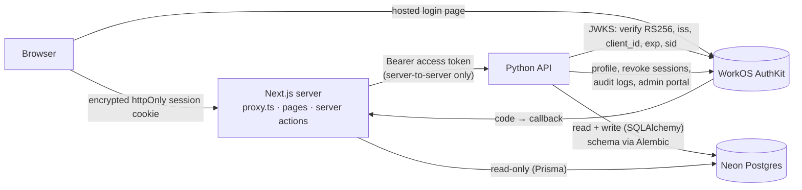

# Auth architecture (Innowhyte POC)

Two apps, one database, one identity provider.

| Piece | Repo | Job |
|---|---|---|
| Next.js 16 app | `auth-poc-workos-innowhyte` | UI, sign-in/sign-up via WorkOS AuthKit, session cookie, admin board |
| Python API (FastAPI) | `mock-backend-innowhyte` | Verifies tokens, makes **every** authorization decision, writes the DB, owns migrations (Alembic), audit trail |
| Postgres (Neon) | shared | `users`, `audit_events`, `alembic_version` |
| WorkOS | SaaS | Hosted login (email, Google, Microsoft, Entra SSO), sessions, Admin Portal, Audit Logs copy |

## Big picture



## Flows

**Sign up / sign in**
1. `/sign-in` or `/sign-up` → `auth.getSignInUrl()` → WorkOS hosted page (PKCE).
2. WorkOS → `/auth/callback` → AuthKit exchanges the code, seals the session into an httpOnly cookie.
3. `onSignedIn` → `POST /api/v1/users/sync` with the new access token.
4. Python verifies the token, **fetches the profile from WorkOS itself**, upserts the user.
   New users get role `user`. Emails in `ADMIN_EMAILS` (verified only) get `admin`.
5. Audit: `user.account.created` (first time) or `user.session.started`.

**Calling the API (role demo)**
1. `proxy.ts` refreshes the session if the access token expires within 60 s (refresh token rotation).
2. Page/action → `backendFetch()` adds `Authorization: Bearer <token>` (never sent to the browser).
3. Python: verify token → load user by `(auth_provider, sub)` → check `is_active` → check role.
4. Denials are written to the audit trail (`authz.admin.denied`, `authz.account.denied`).

**Changing a role (admin board)**
1. Server action re-checks admin in Next.js (friendly error), then `PATCH /users/{id}/role`.
2. Python re-checks admin (authoritative), applies guards (not yourself, not break-glass, keep ≥1 admin),
   writes the change **and** the audit row in one transaction, then copies the event to WorkOS Audit Logs.
3. The next request from that user sees the new role. There's no waiting for their token to expire.

**Suspending a user**: `is_active=false` → blocked on the next request, and all their WorkOS sessions
are revoked so they can't refresh.

## Provider abstraction: WorkOS or Better Auth, switched by env

Set the **same** `AUTH_PROVIDER` in both `.env` files, then restart both apps (redeploy in production).

| | `workos` | `better-auth` |
|---|---|---|
| Login UI | WorkOS hosted page | `app/auth/sign-in`, `sign-up`, `forgot-password`, `reset-password` |
| OAuth callback | `/auth/callback` | Better Auth's `/api/auth/[...all]` |
| Session | Sealed AuthKit cookie | Better Auth DB session (+5 min cookie cache) |
| Token for Python | WorkOS access token (RS256) | 15-min JWT from the JWT plugin (EdDSA, iss/aud = `BETTER_AUTH_URL`) |
| Python verifier | `app/auth/workos.py` | `app/auth/better_auth.py` (JWKS at `{BETTER_AUTH_URL}/api/auth/jwks`) |
| Profile source | WorkOS API (token has no email) | Token claims (`email`, `emailVerified`, `name`, `image`) |
| Admin Portal / Entra SSO self-serve | Yes | No (card hidden, API returns 501) |
| Suspend ends sessions | Yes (WorkOS revoke) | No; every API call is still refused at once |
| Emails (verify, reset) | WorkOS | `lib/auth/better-auth/email.ts` (dev prints links; production needs a sender) |

- Next.js: app code imports only `@/lib/auth`. `lib/auth/index.ts` picks `workos.ts` or
  `better-auth/provider.ts`; `session-provider.tsx` picks the client side. Each provider reads its env vars
  only when first used, so the unused one needs no configuration.
- Better Auth's own tables (user, session, account, verification, jwks) live in `BETTER_AUTH_DATABASE_URL`,
  a **separate database** from `DATABASE_URL` (Alembic owns that one; Prisma stays read-only).
  Create/update them with `npm run auth:migrate`; it refuses to run against `DATABASE_URL`.
- Data: users are keyed by `(auth_provider, external_id)`; roles live in **our** DB. After a switch, a
  person's first sign-in moves their existing row to the new provider (same id, role and audit history,
  audited as `user.account.relinked`), but only when the new provider has **verified** the email.
  An unverified email never takes over an account (409).
- A frontend/backend mismatch shows on the home page as "could not be set up"; with `ENVIRONMENT=local`
  the message names the backend's provider.

## Who owns the schema

Alembic (Python) is the only thing that changes the database. Prisma introspects it:

```bash
# backend
alembic revision --autogenerate -m "..."   # then read the file
alembic upgrade head --sql                  # review
alembic upgrade head                        # apply (direct, non-pooled Neon URL)
alembic check                               # no drift
# frontend
npm run db:pull && npm run db:generate
```

Never run `prisma migrate` or `prisma db push` here.

## Security controls in the code

| Control | Where |
|---|---|
| Hosted login, MFA-capable, no passwords in our systems | WorkOS AuthKit |
| Encrypted httpOnly session cookie, refresh token rotation, early refresh | `lib/auth/workos.ts`, `proxy.ts` |
| Token checked in Next.js (JWKS + `WORKOS_ISSUER`) **and** independently in Python | AuthKit, `app/auth/jwt_verifier.py` |
| Pinned RS256, required `exp/iat/iss/sub/sid`, `client_id` binding, alg-none/HS256 confusion rejected | `app/auth/` + tests |
| Authorization from DB on every request; immediate revocation | `app/api/deps.py` |
| Least-privilege UI + re-check inside every server action | `lib/dal.ts`, `app/admin/actions.ts` |
| Append-only audit trail (trigger), in-transaction with the change, denials included | migration `b7c4e1d2f9a0`, `audit_service.py` |
| Session revocation on suspension | `WorkOSAuthProvider.revoke_sessions` |
| POST-only sign-out | `app/auth/actions.ts` |
| Security headers (frame-ancestors, nosniff, HSTS, referrer, permissions) | `next.config.ts`, `app/main.py` |
| TLS with certificate verification to the DB (`sslmode=verify-full`) | `.env`, `app/db/url.py` |
| Fail closed when WorkOS is unreachable (503, never "allow") | `app/api/deps.py` |
